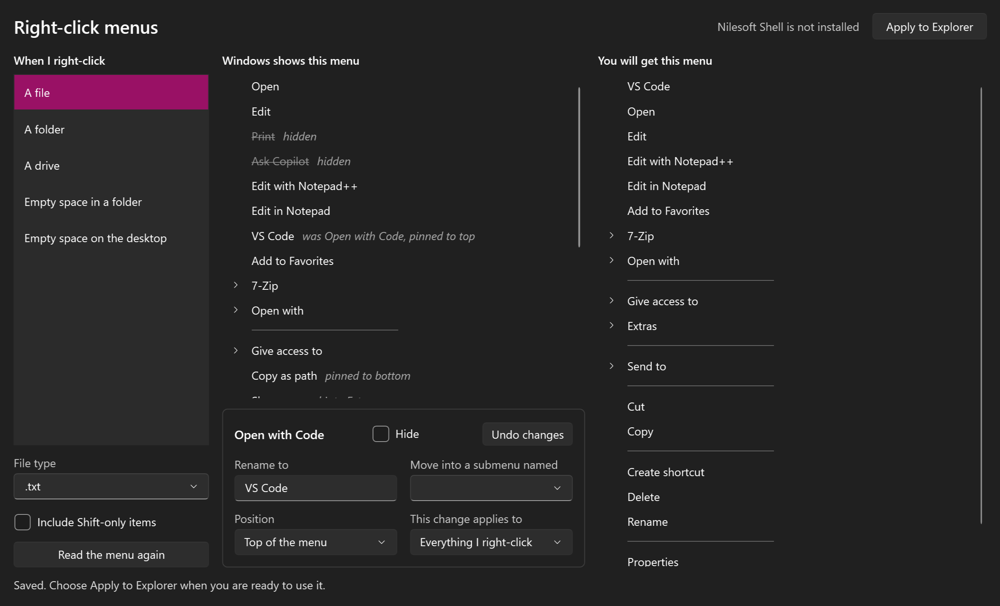

<p align="center">
  
</p>

<h1 align="center">RCConfigurator</h1>

<p align="center">
  See the right-click menu Windows builds for anything you click, and change it.
</p>



The Windows right-click menu is different for every kind of thing you click: a text file, a folder, a drive, the desktop. RCConfigurator shows you the real menu for each one and lets you hide, rename, pin and regroup its items, with a live preview of the result.

> **Status: early.** The editor reads real menus and writes rules. Applying those rules inside Explorer relies on [Nilesoft Shell](https://github.com/moudey/Shell), and that last step has not been tested against a live install yet. Expect rough edges.

## What it does

- **Reads the real menu.** It asks Windows for the menu it would show, including submenus and Shift-only items, so you see every entry your installed programs add.
- **Edits by context.** A change can apply to one file type, to one kind of target (all files, folders, drives, folder backgrounds, the desktop), or to everything you right-click.
- **Previews the result.** The menu you will get is shown beside the menu Windows builds.
- **Applies without admin rights.** Your rules are written to a config file in your own profile and Nilesoft Shell is pointed at it.

## Getting started

You need Windows 10 or 11 and the [.NET 10 SDK](https://dotnet.microsoft.com/download). There are no prebuilt downloads yet.

```
git clone https://github.com/DjjC13/RCConfigurator.git
cd RCConfigurator
dotnet run --project src/RCConfigurator.App
```

To have your changes take effect in Explorer, install the engine:

```
winget install Nilesoft.Shell
```

Then choose **Apply to Explorer** in the editor, and hold Ctrl while you right-click once in Explorer so the engine reloads.

## Documentation

- [User guide](docs/user-guide.md): using the editor, applying and undoing changes, troubleshooting.
- [How it works](docs/how-it-works.md): the probe, the rule model, and how rules become an engine config.

## Not done yet

- Putting items in an arbitrary order. Items can only be pinned to the top or bottom for now.
- Adding new items of your own.
- Editing the menu for several items selected together.

## Building and testing

```
dotnet build
dotnet test
```

Some tests run the probe against the real Windows shell, so they need a normal desktop session.

## Credits

RCConfigurator does not change Explorer itself. That work is done by [Nilesoft Shell](https://github.com/moudey/Shell), an MIT-licensed project by Nilesoft. RCConfigurator is not affiliated with it and does not include it.

## Licence

MIT. See [LICENSE](LICENSE).
