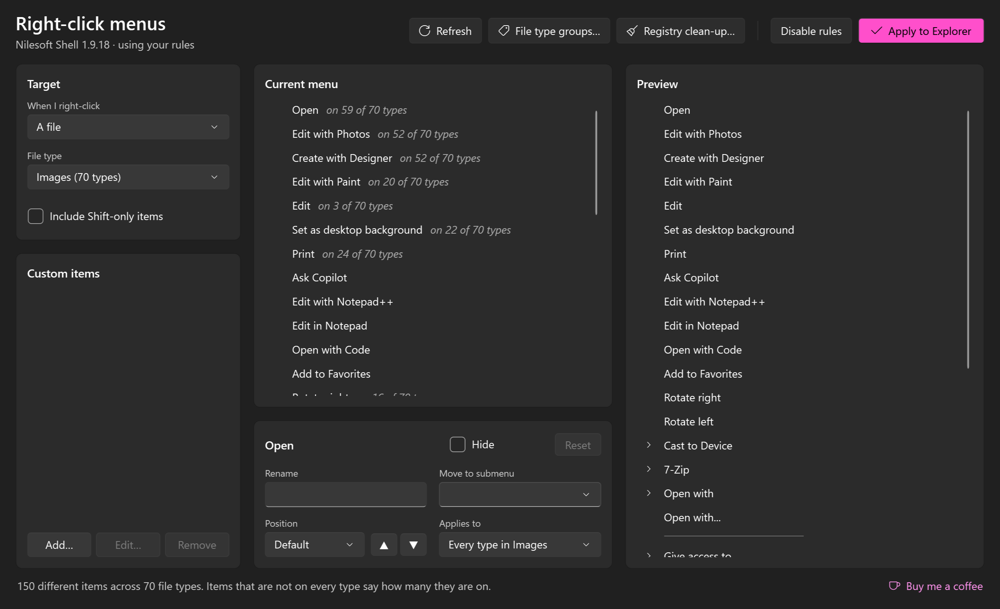
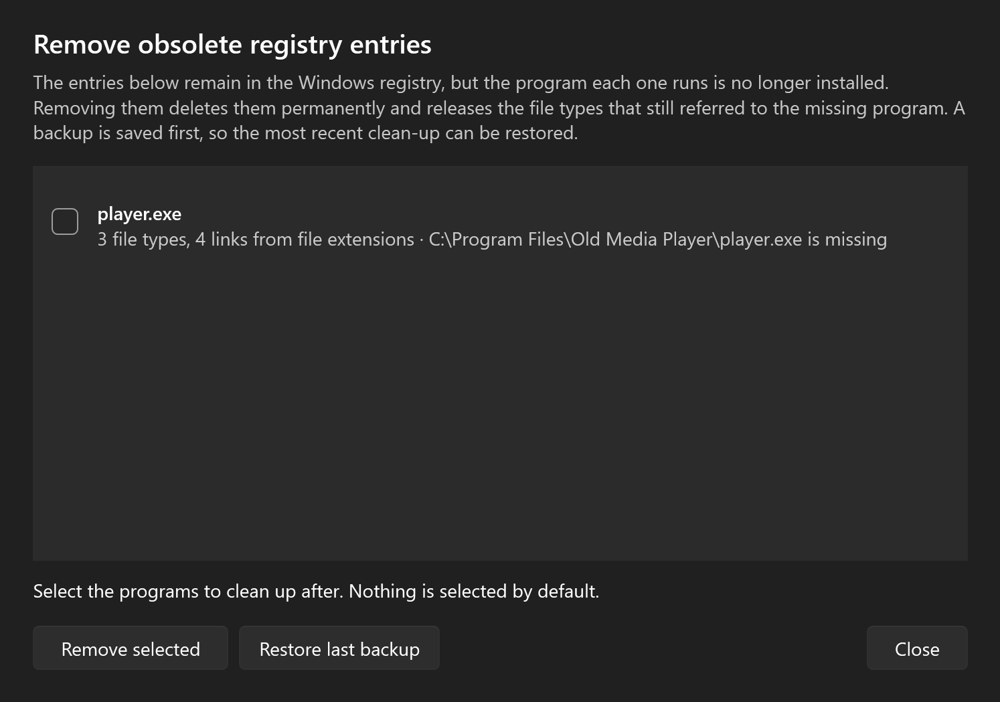

<p align="center">
  
</p>

<h1 align="center">RCConfigurator</h1>

<p align="center">
  See the right-click menu Windows builds for anything you click, and change it.
</p>


The Windows right-click menu is different for every kind of thing you click: a text file, a folder, a drive, the desktop. RCConfigurator shows you the real menu for each one and lets you hide, rename, reorder and regroup its items and add your own, with a live preview of the result.

Changes are applied inside Explorer by [Nilesoft Shell](https://github.com/moudey/Shell), which RCConfigurator installs and looks after for you. It has been developed and used on Windows 11; if something misbehaves on your PC, please [open an issue](https://github.com/DjjC13/RCConfigurator/issues).

## What it does

- **Reads the real menu.** It asks Windows for the menu it would show, including submenus and Shift-only items, so you see every entry your installed programs add.
- **Edits by context.** A change can apply to one file type, to one kind of target (all files, folders, drives, folder backgrounds, the desktop), only when several things are selected, or to everything you right-click.
- **Edits similar file types together.** Pick a group such as Images, Videos or Code and edit one combined menu for all of its types, or make groups of your own. One more entry shows every file type on the PC at once, so an item that appears on hundreds of types is hidden or renamed in one go.
- **Hides, renames, reorders and regroups.** Move any item up or down, pin it to the top or bottom, or collect items into submenus of your own.
- **Adds your own items.** Give an item a name and a program to run, and choose where it appears.
- **Cleans up after uninstalled programs.** It finds menu entries and file types whose program is no longer on the PC, tells you when it opens, and removes them from the registry for good after saving a backup that can be restored.
- **Previews the result.** The menu you will get is shown beside the menu Windows builds.
- **Applies with one click.** Your rules are written to a config file in your own profile, Nilesoft Shell is pointed at it, and Explorer is restarted so they take effect. RCConfigurator itself never needs to run as administrator.
- **Looks after the engine.** It installs Nilesoft Shell, registers it with Windows and keeps it up to date, asking for permission only for the steps that need it.

| Similar file types, edited together | Entries left by uninstalled programs |
|---|---|
|  |  |

## Getting started

Download the zip for your PC from the [latest release](https://github.com/DjjC13/RCConfigurator/releases), unzip it anywhere, and run `RCConfigurator.exe`. You do not need to install .NET.

- `win-x64` is for most PCs.
- `win-arm64` is for Windows on ARM, such as Snapdragon laptops. Use it there rather than the x64 build, so the editor sees the same menu items Explorer does.

The builds are not code-signed, so Windows SmartScreen may warn the first time you run one.

Each time it starts, RCConfigurator checks three things and opens the editor only once all are in place:

1. **Nilesoft Shell is installed.**
2. **Windows 11 is set to show the classic right-click menu.** Windows 10 already uses it.
3. **Nilesoft Shell is registered with Windows and running in Explorer.**

If anything is missing, **Set these up for me** does the lot: it installs the engine with `winget`, changes the menu setting, registers the engine and restarts Explorer. Windows asks for permission for the install and the registration.

Then make your changes and choose **Apply to Explorer**. Explorer restarts by itself and your menus are live; open folder windows close when it does.

## Documentation

- [User guide](docs/user-guide.md): using the editor, applying and undoing changes, troubleshooting.
- [How it works](docs/how-it-works.md): the probe, the rule model, and how rules become an engine config.

## What it downloads

To sort file types into groups, RCConfigurator starts with the labels Windows itself gives them. For types Windows does not label, it downloads two public lists and matches against them on your PC:

- [mime-db](https://github.com/jshttp/mime-db), which maps file extensions to IANA media types;
- [GitHub Linguist's language list](https://github.com/github-linguist/linguist), which says which extensions hold code.

The lists are downloaded whole and kept for 30 days, so nothing about your own files or file types is sent anywhere. Start the app with `--offline` to skip the downloads; the groups then hold only what Windows labels. It also asks `winget` whether Nilesoft Shell has an update.

## Known limits

- Rules match items by their title, so two programs that add items with the same title are changed together.
- Rules for a whole group of file types are written with the same test the single-type rules use, but have had less use than the rest. Please report one that does not take effect.
- Mixed selections, such as files and folders selected together, cannot be given their own rules.
- Custom items cannot be given an icon of your choice, and a submenu cannot be put inside another submenu.

## Building from source

You need the [.NET 10 SDK](https://dotnet.microsoft.com/download).

```
git clone https://github.com/DjjC13/RCConfigurator.git
cd RCConfigurator
dotnet run --project src/RCConfigurator.App
dotnet test
```

Some tests run the probe against the real Windows shell, so they need a normal desktop session.

## Support

RCConfigurator is free and open source. If it saves you time, you can [buy me a coffee](https://buymeacoffee.com/djjc13).

## Credits

RCConfigurator does not change Explorer itself. That work is done by [Nilesoft Shell](https://github.com/moudey/Shell), an MIT-licensed project by Nilesoft. RCConfigurator is not affiliated with it and does not include it.

## Licence

MIT. See [LICENSE](LICENSE).
