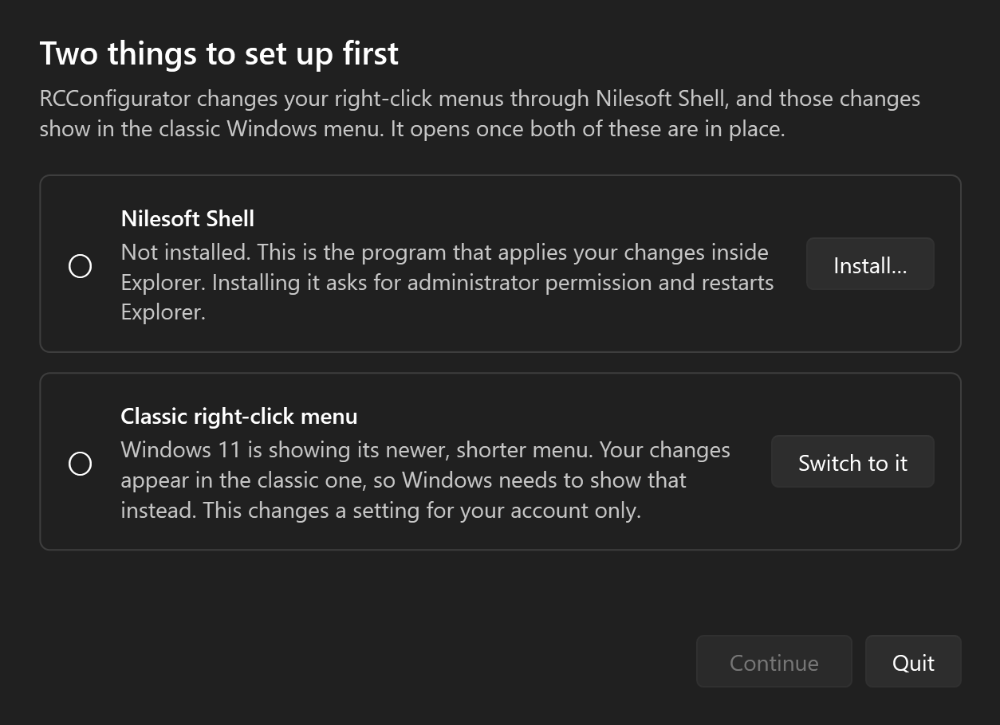

# User guide

## First launch



RCConfigurator needs two things before it opens the editor. If either is missing it shows this window instead, and **Continue** stays greyed out until both are ticked.

1. **Nilesoft Shell.** This is the program that applies your changes inside Explorer. **Install…** runs the Windows package manager (`winget install Nilesoft.Shell`) in its own window. It asks for administrator permission and restarts Explorer. If the package manager is not available, the download page opens instead; install it from there and come back.
2. **Classic right-click menu.** Windows 11 normally shows a shorter menu with "Show more options" at the bottom. Your changes appear in the classic menu, so **Switch to it** tells Windows to show that one straight away. It is a setting for your account only, and it takes effect when Explorer next restarts: installing Nilesoft Shell does that, and so does signing out and back in. On Windows 10 this step is already done.

**Quit** closes RCConfigurator without changing anything further. The window checks again whenever you return to it, so you can also do either step yourself.

## The window

The editor has three columns.

1. **When I right-click** is where you choose what was clicked: a file, several files, a folder, several folders, a drive, empty space in a folder, or empty space on the desktop. For files you also choose the file type, because Windows builds a different menu for each one. Below it, **My own items** lists the items you have added.
2. **Windows shows this menu** is the menu Windows builds for that target right now, read live from your system. Your changes are marked on it: hidden items are struck through, and renamed or moved items carry a note.
3. **You will get this menu** is a preview of the result once your rules are applied.

Tick **Include Shift-only items** to also see entries that normally appear only while you hold Shift. **Read the menu again** re-reads the menu, which is useful after you install or remove a program.

## Changing an item

Select an item in the middle column. The panel underneath lets you:

- **Hide** it.
- **Rename** it.
- **Move it into a submenu.** Type a name to create a submenu, or pick one you have already made. Several items can share a submenu.
- **Change its position.** Pin it to the top or bottom of the menu, or use the ▲ and ▼ buttons to move it one row at a time. Moving past a separator line puts the item in the next group.

**Undo changes** removes every change you made to the selected item.

A moved item is remembered as sitting just above or below a neighbouring item, not as a row number. It therefore stays beside that neighbour when you hide or add other items. If the neighbour does not exist in some other menu the rule applies to, the item goes to the bottom of that menu.

Items inside a submenu, such as the entries under 7-Zip, can be changed the same way. Expand the submenu and select the item.

## Choosing where a change applies

Each change has a scope, set with **This change applies to**:

| Scope | Example |
|---|---|
| One file type | Only `.txt` files |
| One kind of target | All files, or only folders, or only the desktop |
| Only several at once | Only when several files, or several folders, are selected together |
| Everything | Everything you right-click |

To make a change that applies only when several things are selected, choose **Several files** or **Several folders** on the left first. The narrower scopes are offered there.

New changes start with the scope you used last. When rules overlap, the narrower one wins: a rule for `.txt` files overrides a rule for everything.

Rules match items by their title. If two programs add items with the same title, a rule affects both.

## Adding your own items

Under **My own items**, choose **Add…** and fill in:

- **Name shown in the menu.**
- **Program to run.** Type a path or use **Browse…**. A program on your PATH, such as `notepad.exe`, works without a full path.
- **What to pass to it.** `%1` stands for the path of whatever you right-clicked. Keep the quotes around it so paths with spaces work.
- **Show it when I right-click.** Any file, files of one type, a folder, a drive, empty space in a folder, empty space on the desktop, or anything.
- **Position** and, optionally, a **submenu** to put it in.

When several things are selected, the program is run once for each of them.

Select an item in the list and choose **Edit…** or **Remove** to change or delete it. Double-clicking an item also edits it.

## Applying your changes

Changes are saved as you make them, but Explorer does not use them until you apply.

1. Choose **Apply to Explorer**.
2. Hold Ctrl and right-click once in Explorer. This makes the engine reload its config.

The top right of the window shows whether the engine is installed and whether it is using your rules.

## Going back

- **Stop using my rules** returns Nilesoft Shell to its own settings. Hold Ctrl and right-click once to reload.
- To remove the engine, uninstall it: `winget uninstall Nilesoft.Shell`.
- To return to the Windows 11 menu, delete the setting the first-launch window added, then sign out and back in:

  ```
  reg delete "HKCU\Software\Classes\CLSID\{86ca1aa0-34aa-4e8b-a509-50c905bae2a2}" /f
  ```
- Holding Ctrl and the Windows key while you right-click turns the engine off and shows the classic Windows menu. Holding Ctrl while you right-click turns it back on.

## Where things are kept

| What | Where |
|---|---|
| Your rules | `%APPDATA%\RCConfigurator\profile.json` |
| The config written for the engine | `%LOCALAPPDATA%\RCConfigurator\shell.nss` |
| Sample files the probe right-clicks | `%LOCALAPPDATA%\RCConfigurator\samples` |
| The setting that points the engine at the config | `HKCU\Software\Nilesoft\Shell`, value `config` |
| The classic-menu setting | `HKCU\Software\Classes\CLSID\{86ca1aa0-34aa-4e8b-a509-50c905bae2a2}\InprocServer32` |

Deleting the first three resets RCConfigurator. RCConfigurator itself writes nothing outside your own user profile; installing Nilesoft Shell is a normal program install.

## Troubleshooting

**The menu in Explorer has not changed.** Hold Ctrl and right-click once to reload. If it still has not changed, look for errors in `shell.log` in the engine's folder, usually `C:\Program Files\Nilesoft Shell`.

**"Could not read the menu."** A shell extension may have stalled or crashed while the menu was being read. Choose **Read the menu again**. If one target always fails, a program that adds items to that menu is the likely cause.

**An item is missing from the middle column.** The editor shows the classic menu, the one behind "Show more options" on Windows 11. Items that exist only in the Windows 11 menu do not appear, and the engine replaces that menu anyway.

**A rule does not match on other files.** Some titles include the name of what you clicked, such as `Add to "report.zip"`. The editor matches those by the part before the name. If a title is built some other way, the rule may only match the sample file.
